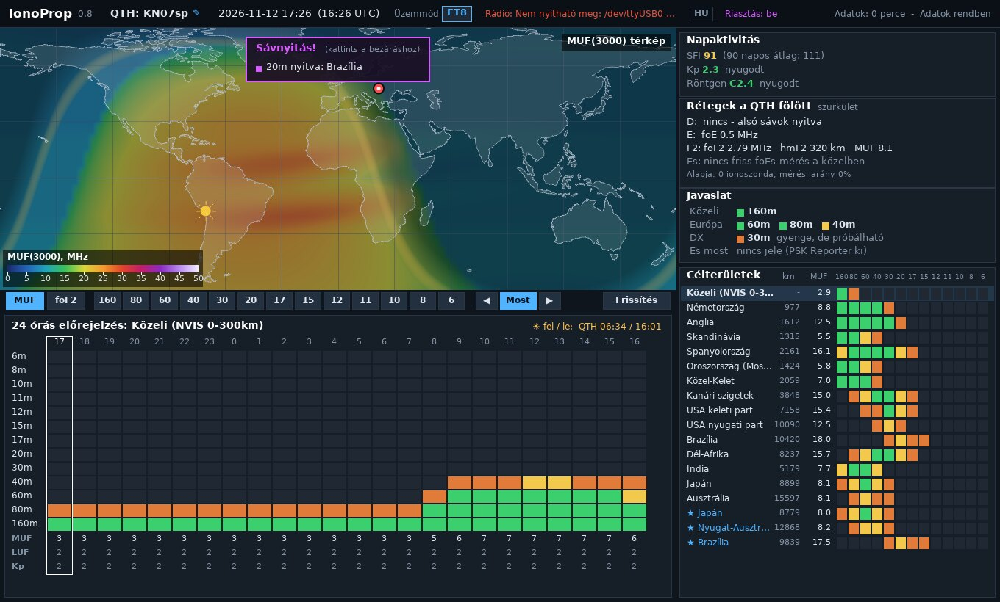

# IonoProp 0.9.1 – ionoszféra-térkép, sávjavaslat, ellenőrzés valódi vételekkel

*English: [README.md](README.md)*

Ionoszféra-állapot és sávjavaslat rádióamatőröknek. A program letölti az
aktuális ionoszonda- és napadatokat, kiszámolja a rétegek állapotát a QTH
fölött, majd 15 célterületre (és a `-T` kapcsolóval megadottakra) sávonként
megmondja, hol érdemes rádiózni.



**Letöltés:** [Releases](https://github.com/hg0mv/ionoprop/releases) ·
**Weboldal:** https://hg0mv.github.io/ionoprop/ ·
**Leírás:** [Wiki](https://github.com/hg0mv/ionoprop/wiki) ·
**Támogatás:** [Ko-fi](https://ko-fi.com/hg0mv)

## Mit tölt le

| Adat | Forrás | Frissítés |
|---|---|---|
| Ionoszondák: foF2, MUF(3000), hmF2, megbízhatóság | prop.kc2g.com (GIRO hálózat) | 15 percenként |
| SFI (10,7 cm-es napfluxus) + 90 napos átlag | NOAA SWPC | 5 percenként |
| Kp-index (1 perces becslés) | NOAA SWPC | 5 percenként |
| Röntgenfluxus, fler-osztály (GOES, 0,1–0,8 nm) | NOAA SWPC | 5 percenként |
| Kp-előrejelzés (3 nap, 3 órás szakaszok) | NOAA SWPC | óránként |

A letöltött fájlok a `~/.cache/ionoprop/` könyvtárba kerülnek. Ha a fájl
még friss, a program nem tölti le újra (a KC2G kéri, hogy ne terheljük a
szerverét). Ha a letöltés nem sikerül, a régi adatot használja.

## Fordítás (Ubuntu)

```
sudo apt install build-essential libcurl4-openssl-dev libx11-dev libfreetype-dev \
                 libmosquitto-dev fonts-dejavu-core
make             # mindkét program: ionoprop és ionoprop-gui
make test        # tesztek mintaadatokon, internet nélkül
make install     # ~/.local/bin alá másolja, menüpontot és ikont is tesz (nem kötelező)
make uninstall   # eltávolítás
```

Ha csak a parancssori program kell (X11 és FreeType nélkül): `make ionoprop`.
PSK Reporter-es ellenőrzés nélkül (libmosquitto nélkül): `make NOPSK=1`.
A JSON-feldolgozó (cJSON) a `third_party/` mappában van, külön telepíteni nem kell.

## Raspberry Pi: shack-kijelző

Az IonoProp Raspberry Pi-n is fut (Pi 3, 4, 5, Raspberry Pi OS 64 bit
ajánlott), így egy kis kijelzővel állandóan bekapcsolt „shack-kijelző”
lehet belőle, mint régen a HamClock. A fordítás ugyanaz, mint Ubuntun:

```
sudo apt install build-essential libcurl4-openssl-dev libx11-dev libfreetype-dev \
                 libmosquitto-dev fonts-dejavu-core
make
make autostart   # telepít, és bejelentkezéskor teljes képernyőn indul
```

A `make autostart` a programot a `~/.local/bin` alá teszi, és felvesz egy
automatikus indítást (`~/.config/autostart/ionoprop.desktop`) ezekkel a
kapcsolókkal: `-F` teljes képernyő, `-C 30` a térkép 30 másodpercenként vált
(MUF, foF2, 40, 20, 15, 10 m). Más kapcsolókkal:
`make autostart KIOSK_ARGS="-F -C 60 -N"`. Kikapcsolás: `make no-autostart`.

- **Kis kijelzőn** (1024x600, 800x480) a program magától kicsinyít, hogy
  minden elférjen. 800x480-on a betűk kicsik; 1024x600 vagy nagyobb ajánlott.
  Kézzel: `IONOPROP_SCALE=0.8`.
- **Teljes képernyő:** `F11` be/ki, `Esc` kilép belőle (a programból nem).
  A mozdulatlan egérmutató 4 másodperc után eltűnik.
- **Bekapcsoláskor** ha még nincs hálózat, a program percenként újrapróbálja
  a letöltést, nem kell 15 percet várni.
- **A képernyő ne kapcsoljon ki:** `sudo raspi-config` → Display Options →
  Screen Blanking → No.
- Ha az automatikus indítás nem működik (régebbi vagy egyedi asztal), a
  `~/.config/labwc/autostart` fájlba is beírható:
  `~/.local/bin/ionoprop-gui -F -C 30 &`
- Ablakkezelő nélkül (csak X, kioszk) is teljes képernyőt tölt ki.

## Windows-változat

Linuxon fordítható Windowsra (keresztfordítás), MinGW-w64-gyel:

```
sudo apt install mingw-w64 zip
make windows     # win/IonoProp.exe és win/ionoprop-cli.exe
make win-zip     # win/IonoProp-0.9.1-windows.zip (a két program + OLVASSEL.txt + README.txt)
```

Mindkét `.exe` egyetlen fájl, külön DLL és telepítés nem kell hozzájuk
(Windows 10 és 11, 64 bit). Ami Windowson másképp működik:

| | Linux | Windows |
|---|---|---|
| ablak, billentyűzet, egér | X11 (`src/platform_x11.c`) | Win32 (`src/platform_win32.c`) |
| szöveg | FreeType, DejaVu Sans | GDI, Segoe UI |
| letöltés | libcurl | WinHTTP (a Windows része) |
| PSK Reporter | libmosquitto | saját MQTT-kliens (mint Androidon) |
| beállítások | `~/.config/ionoprop` | `%APPDATA%\IonoProp` |
| gyorsítótár | `~/.cache/ionoprop` | `%LOCALAPPDATA%\IonoProp\cache` |

A felhasználóknak szóló leírás: [win/OLVASSEL.txt](win/OLVASSEL.txt) (angolul: [win/README.txt](win/README.txt)).

## Android-app

Az `android/` mappában van, ugyanazzal a C-maggal. Fordítás és telepítés
lépésenként: [android/README-android.md](android/README-android.md).
Google Play-re feltöltés: [android/play/README-play.md](android/play/README-play.md).

## Grafikus felület: `ionoprop-gui`

```
./ionoprop-gui                  # első indításkor megkérdezi a lokátort
./ionoprop-gui -g 1600x950      # ablakméret
./ionoprop-gui -N               # PSK Reporter nélkül
./ionoprop-gui -F -C 30         # teljes képernyő, a térkép 30 mp-enként vált
```

**A saját QTH lokátor** a programon belül állítható: kattints a fejlécben a
„QTH: …” feliratra (vagy nyomd meg az `L` billentyűt), írd be, és Enter. A
program elmenti (`~/.config/ionoprop/settings.conf`), és legközelebb – a
parancssori `ionoprop` is – ezt használja. A `-l` kapcsoló továbbra is
működik, ilyenkor az az egy futás azzal a lokátorral megy (nem menti el).


- **Sporadikus E:** a valódi vételek közül azok, amelyek rövid úton, jóval
  az F2 MUF fölött jöttek, Es-nek számítanak. Az útjuk közepe lila
  „felhőként” látszik a térképen (sávos térképen az adott sávé, MUF-térképen
  a 10 m fölöttieké), a „Javaslat” alatt az „Es most” sor mutatja, melyik
  sávon van Es-nyitás (legalább 2 különböző állomáspár). A közeli
  ionoszondák foEs-mérése (1200 km-en belül, 90 percen belüli) a „Rétegek”
  alatt látszik, a belőle számolt Es-MUF-fal (2000 km-es úton kb. 5,3 × foEs).
- **Kp-előrejelzés:** a NOAA 3 napos előrejelzése (óránként letöltve). A
  24 órás előrejelzés alján külön sorban látszik; 1,5 óránál későbbre ezzel
  számol a sarki zavarnál, és ha a mostaninál erősebb vihar várható, a
  közepes és magas szélességen átmenő utak MUF-ját csökkenti.
- **Sávok:** 160 m-től 10 m-ig, plusz a 11 m (27 MHz, CB / „freeband”),
  a 8 m (40,68 MHz) és a 6 m (50 MHz).
- **Üzemmód:** SSB, CW vagy FT8 (a fejlécben kattintásra, vagy `u`). A CW kb.
  8 dB-lel, az FT8 kb. 16 dB-lel több elnyelést bír, és a MUF-ot is kissé
  meghaladhatja, ezért ugyanaz az út FT8-cal még nyitott lehet, SSB-vel már
  nem. A választást a program megjegyzi. Az ellenőrzés (PSK Reporter-statisztika)
  mindig az SSB-határokkal számol, hogy összevethető maradjon.
- **Saját célterületek:** `t` (vagy `+`): lokátor (`PM95`), hívójel
  (`JA1ABC`, `EA8/HA5X`) vagy prefix (`VK6`, `ZS`). Kb. 200 prefixet ismer,
  az USA-ban a hívókörzet számjegyét is (W6 = Kalifornia). A térképen
  kijelölt pontot `s` menti el. Törlés: kijelölés, majd `Delete`. Legfeljebb
  10, a `targets.conf` fájlba mentve; a parancssori program is használja.
- **Hosszú út:** `h` a kijelölt célnál átvált a hosszú útra (long path): a
  térképen a nagykör másik fele látszik, a táblázatban „(LP)” jelzéssel.
- **Szürkevonal:** a napkelte/napnyugta sávja halvány arany színnel látszik a
  térképen; az előrejelzés fejlécében a QTH és a cél napkeltéje, napnyugtája
  (helyi idő szerint).
- **Rádió (Yaesu CAT, pl. FT-891):** `x` (vagy a fejlécben a „Rádió” felirat):
  port és sebesség, pl. `/dev/ttyUSB0,38400` vagy `COM5,38400`. Utána jobb
  kattintás egy sávcellára a táblázatban (vagy egy sávgombra) → a rádió arra a
  sávra áll, a választott üzemmód szokásos frekvenciájára (FT8: 14,074 stb.,
  DATA-USB módban). Csak frekvenciát és módot küld, adásba nem kapcsol; a DTR
  és RTS jelet megnyitáskor kikapcsolja. Linuxon a felhasználónak a `dialout`
  csoportban kell lennie.
  A MUF-színskála 50 MHz-ig tart (35 MHz fölött lila, 50 MHz-nél fehér), így
  a magas, low-VHF F2 MUF-ok is látszanak a térképen.
- **Térkép:** MUF(3000) vagy foF2 színtérkép, vagy sávonként „hová jut el a
  jelem” (zöld jó, sárga közepes, narancs gyenge). Éjszakai árnyék, a Nap
  helye, az ionoszondák (színük a mért MUF), a QTH (piros) és a kijelölt cél
  útvonala az ugrási pontokkal.
- **Jobb oldalt:** napaktivitás, rétegek a QTH fölött, javaslat (közeli /
  Európa / DX), célterületek táblázata sávonként.
- **Alul:** 24 órás előrejelzés a kijelölt célra (sávok × órák, MUF, LUF).
- **Időcsúszka:** a ◀ ▶ gombokkal vagy a nyilakkal 0-23 órát előre lehet
  lépni – a térkép, a rétegek és a táblázat az adott időpontra számol.
- **Valódi vételek (PSK Reporter):** sávos térképen fehér pontok jelzik, hova
  jutott el ténylegesen jel a környékedről az utóbbi 30 percben; a
  célterület-táblázatban jelzés mutatja, ha arra volt vétel: **teli fehér
  pötty** = erős jel (≥ −10 dB, SSB-n is hallható lenne), **szürke karika** =
  csak gyenge, FT8-szintű jel (ez szórással, rövid nyitással is átjuthat,
  amikor a sáv „rendesen” nincs nyitva). Így közvetlenül látod, egyezik-e
  az előrejelzés a valósággal. A jelzéshez
  legalább 2 különböző állomáspár kell, a távoli végnek 800 km-en belül
  kell lennie a célhoz, és az útnak hasonló hosszúnak (±25-35%); a
  „Közeli” sorhoz csak a 100-300 km-es utak számítanak.
- **Riasztás sávnyitáskor:** a program percenként ránéz, és ha valami
  kinyílt, felugró sávot mutat a térkép tetején (és sípol):
  sporadikus E 10 / 8 / 6 m-en (valódi vételek vagy a közeli ionoszonda),
  F2 nyitás 8 / 6 m-en bármelyik cél felé, és ha a saját (★)
  célterületeid felé 20 és 10 m között legalább közepes lesz egy sáv.
  Ugyanarra legfeljebb 3 óránként szól. Ki/be: `a`, vagy kattintás a
  fejlécben a „Riasztás” feliratra. Az állapotot az `alerts.state` fájl
  őrzi, így újraindítás után sem jelez újra ugyanarra.
- **Meteorraj:** a Javaslat alatt a „Meteor” sor mutatja az aktív vagy a
  következő meteorrajt (pl. Geminidák, december 14.), a csúcsig hátralévő
  időt, a ZHR-t és azokat az UTC-órákat, amikor a rádiáns a QTH-ról legalább
  25° magasan áll: ekkor jó a meteorszórás 6 és 2 m-en. A csúcs előtti és
  utáni napon riasztás is jön (rajonként évente egyszer).
- **Magyarázatok:** a fejlécben a `?` gomb (vagy a `?` billentyű) megmutatja,
  mit jelentenek az értékek (SFI, Kp, MUF, foF2, LUF, Es, ZHR, színek…).
- **Távolság:** km vagy mérföld (`k`). A program megjegyzi.
- **Nyelv:** magyar vagy angol (`n`, vagy a fejlécben a HU / EN gomb). A
  program megjegyzi. A parancssori program magyar marad.
- **Nagy felbontású kijelző:** Windowson a rendszer nagyítását (pl. 150%)
  magától követi, éles betűkkel. Linuxon az `IONOPROP_SCALE` környezeti
  változóval adható meg, pl. `IONOPROP_SCALE=1.5 ./ionoprop-gui`.
- 15 percenként magától frissít.

| Billentyű / egér | Mit csinál |
|---|---|
| ← → (vagy görgő) | idő -1 / +1 óra |
| ↑ ↓ | cél kijelölése a listában |
| m / f | MUF / foF2 térkép |
| 1 … 9, 0, -, = | sávlefedettség: 160, 80, 60, 40, 30, 20, 17, 15, 12, 10, 8, 6 m |
| c | 11 m (CB) |
| u, vagy kattintás az üzemmódra | üzemmód: SSB → CW → FT8 |
| t vagy + | új célterület (lokátor, hívójel, prefix) |
| s | a térképen kijelölt pont mentése célterületként |
| Delete | a kijelölt saját célterület törlése |
| h | hosszú út ki/be a kijelölt célnál |
| x, vagy kattintás a „Rádió” feliratra | rádió (CAT) beállítása |
| jobb kattintás egy sávra | a rádió arra a sávra áll |
| L, vagy kattintás a „QTH” feliratra | saját lokátor beírása |
| p | valódi vételek (spotok, Es-felhők) ki/be |
| a, vagy kattintás a „Riasztás” feliratra | riasztás sávnyitáskor ki/be |
| n, vagy kattintás a HU / EN gombra | nyelv: magyar / angol |
| r | adatok frissítése most |
| k | távolság: km / mérföld |
| ?, vagy kattintás a „?” gombra | magyarázatok az értékekhez |
| F11 | teljes képernyő be/ki |
| Esc | teljes képernyőn: kilépés a teljes képernyőből; különben a programból |
| q | kilépés |
| kattintás a térképen | új cél azon a ponton (útvonal + előrejelzés) |
| kattintás a táblázat sorára | cél kijelölése |
| kattintás az előrejelzésen | ugrás arra az órára |

## Parancssori program: `ionoprop`

```
./ionoprop                 # a grafikus programban beállított lokátorral
./ionoprop -l JN97xx       # más lokátorral (csak erre a futásra)
./ionoprop -n 12 -a 3      # 12 állomás, max. 3 órás mérések
./ionoprop -T FN20 -T VK6  # további célterületek: lokátor, hívójel vagy prefix
./ionoprop -u FT8          # üzemmód (SSB, CW, FT8)
./ionoprop -F list         # célterületek listája
./ionoprop -F 2            # 24 órás előrejelzés a 2. célra (vagy -F FN20)
./ionoprop -s              # csak az adatok, sávjavaslat nélkül
./ionoprop -C              # színek nélkül (pl. fájlba íráshoz)
./ionoprop -f              # letöltés akkor is, ha van friss adat
./ionoprop -h              # súgó
```

Kapcsolók: `-l` lokátor, `-n` állomások száma, `-a` max. kor órában,
`-c` minimális megbízhatóság (0–100, alap 25; a kézzel kiértékelt mérés mindig látszik).

## Ellenőrzés valódi vételekkel (PSK Reporter)

A program feliratkozik a PSK Reporter MQTT-szerverére (`mqtt.pskreporter.info`)
a QTH körüli (alapból 300 km-es) körzet lokátornégyzeteire, adóként és
vevőként is. Minden olyan spot beérkezik, amelynek egyik vége a közeledben
van – nem csak a saját hívójeledé. Minden spotnál kiszámolja, mit jósolt
volna arra az útra, frekvenciára és időre, és naplózza
(`~/.cache/ionoprop/spots_eval.csv`). A grafikus program futás közben
folyamatosan gyűjt.

```
./ionoprop -l KN07sp -P 60      # 60 percig gyűjt, utána kiértékel
./ionoprop -l KN07sp -V 7       # kiértékelés az utolsó 7 nap naplójából
./ionoprop -l KN07sp -V 7 -W    # ... és a javasolt paraméterek mentése
```

A jelentés sávonként megmutatja, hogy a valódi vételek milyen jóslatú
utakra estek, a találati arányt, a „zárva” jóslatok okát, és javaslatot
tesz a MUF-szorzóra és az elnyelési határokra. A mentett értékek a
`~/.config/ionoprop/params.conf` fájlba kerülnek, és mindkét program
ezekkel számol (a fájl törlésével visszaállnak az alapértékek).

Fontos korlátok:
- A spotok csak azt mutatják, ami **működött**. Ha egy sávon nincs spot,
  abból nem tudni, hogy zárva volt-e (lehet, hogy senki sem adott). Ezért
  a hangolás csak **lazítani** tud a határokon, szigorítani nem.
- A spotok nagy része FT8, ami nagyon gyenge jeleket is vesz.
- A 100 km alatti spotokat (földi hullám) a program eldobja.
- A rövid utakon (2300 km alatt), 20 m-en és feljebb, jóval a MUF fölötti
  spotok nem F2 terjedésből jönnek (sporadikus E, szórás, hibás lokátor);
  ezeket a program külön számolja, a statisztikából és a hangolásból kihagyja.
  A MUF-hangolás egyébként is csak a 2000 km-nél hosszabb utakat használja.
- Javaslatot csak legalább 300 spot, 100 erős jel és **6 órányi** adat után
  ad, hogy ne egyetlen pillanatnyi helyzetből hangoljon.

## Fájlok

```
src/data.h     közös adatszerkezetek (PropData, IonoStation, SolarData)
src/fetch.c    letöltés (libcurl / WinHTTP), gyorsítótár
src/parse.c    JSON feldolgozás
src/geo.c      lokátor, távolság, irányszög, nagykör menti pontok
src/solar.c    a Nap helyzete, geomágneses szélesség
src/model.c    ionoszféra-modell bármely pontra (foF2, M3000, hmF2, foE)
src/predict.c  ugrásgeometria, MUF/LUF, elnyelés, sávértékelés
src/loader.c   minden forrás letöltése egy lépésben
src/main.c     parancssori program, kiírás
src/gui.c      grafikus felület (rajzolás, vezérlés)
src/platform_x11.c   ablak és események Linuxon (X11)
src/platform_win32.c ablak és események Windowson
src/compat.c   Linux / Windows különbségek (könyvtárak, fájlok, konzol)
src/canvas.c   rajzolás pixeltömbbe, szöveg FreeType-pal
src/mapview.c  világtérkép, színtérkép, lefedettség
src/map_data.c szárazföldek körvonala (Natural Earth 1:110m, közkincs)
src/pskr.c     PSK Reporter MQTT-gyűjtő (libmosquitto / saját kliens)
src/spots.c    valódi vételek: célterület-jelzés, sporadikus E, térképrajz
src/targets.c  saját célterületek, prefix-táblázat
src/rig.c      rádióvezérlés (Yaesu CAT) soros porton
src/alerts.c   riasztás sávnyitáskor (feltételek, "csak az új" szűrés)
src/i18n.c     magyar / angol felület
src/validate.c spotok kiértékelése, napló, statisztika, hangolási javaslat
src/config.c   hangolt paraméterek mentése / betöltése
src/cache.c    gyorsítótár-könyvtár, fájlbeolvasás
src/appcore.c  felülettől független app-mag (az Android-app használja)
src/jni_bridge.c JNI-híd az Android-apphoz
android/       Android-projekt (Kotlin + a fenti C-mag)
win/           Windows: ikon, manifeszt, erőforrás-fájl, OLVASSEL.txt
test/          teszt és mintaadatok
```

## Hogyan számol

1. **Modell bármely pontra:** egyszerű alapmodell (SFI + a Nap állása,
   az F2 réteg 1,5 órás késésével, a téli anomáliával, az egyenlítői
   anomáliával és nagyon magas SFI-nél telítődéssel), amit a közeli
   ionoszondák mérései korrigálnak (kb. 1500 km-es körzetben). Ahol nincs mérés, ott csak
   becslés (`~` jel a táblázatban).
2. **Útvonal:** ugrásokra bontás (F2: max. kb. 3500 km, 3°-os kisugárzási
   szöggel), minden ugrás közepén lekérdezi a modellt. Az ugrás MUF-ja
   úgy van számolva, hogy 3000 km-en pontosan a mért MUF(3000) jöjjön ki.
   Nappal az E réteget is figyelembe veszi (max. 2000 km-es ugrás).
3. **Elnyelés (D réteg):** a napállásból és a frekvenciából, ugrásonként
   (egyszerűsített ITU-R P.533 jellegű képlet). Ebből jön a LUF.
4. **Zavarok:** M1 feletti napkitörés a nappali oldalon elnémítja az alsó
   sávokat; Kp ≥ 4 esetén a sarki fény övezetén átmenő utak rosszabbak.
5. **Előrejelzés:** a jövőbeli órákra a mért eltérés fokozatosan (kb. 5
   óra alatt) átadja a helyét az alapmodellnek, a geomágneses állapotot
   változatlannak veszi, napkitörést nem jelez előre.
6. **Értékelés sávonként:** +++ jó (az optimális frekvencia, 0,85×MUF alatt),
   ++ közepes, + gyenge/esetleges, . zárva.

Az elnyelési határok alapértékei tapasztalatiak; a PSK Reporter-es
ellenőrzéssel hangolhatók (lásd fent).

## Licenc

Az IonoProp szabad szoftver: a **GNU General Public License 3.0** (GPL-3.0)
feltételei szerint szabadon használható, másolható, módosítható és
továbbadható. Aki módosítva adja tovább, annak a módosított forrást is
ugyanígy, GPL-3.0 alatt kell közzétennie. A teljes szöveg: [LICENSE](LICENSE).

Copyright © 2026 HG0MV

Felhasznált részek: cJSON (MIT-licenc, `third_party/cJSON-LICENSE`),
Natural Earth térképadatok (közkincs).

## Változások

- **0.9.1:** meteorraj-naptár (riasztással), magyarázatok az értékekhez,
  km / mérföld, kíméletesebb letöltés a KC2G-ről (kézi frissítésnél is
  legalább 5 perc, hiba után egyre hosszabb szünet)
- **0.9:** teljes képernyős shack-kijelző mód (`F11`, `-F`, körbejáró térkép
  `-C`), Raspberry Pi támogatás (kis kijelzők, `make autostart`), menüpont és
  ikon telepítéskor
- **0.8:** riasztás sávnyitáskor (asztali felugró sáv, Androidon értesítés),
  angol nyelv, Android kezdőképernyő-widget, éles megjelenítés nagyított
  Windows-kijelzőn (és Linuxon `IONOPROP_SCALE`)
- **0.7:** saját célterületek (lokátor, hívójel, prefix), SSB / CW / FT8,
  szürkevonal és hosszú út, 11 m, Yaesu CAT
- **0.6:** sporadikus E, jobb modell magas MUF-ra, Kp-előrejelzés
- **0.5:** 8 m és 6 m, MUF-skála 50 MHz-ig, Windows-változat
